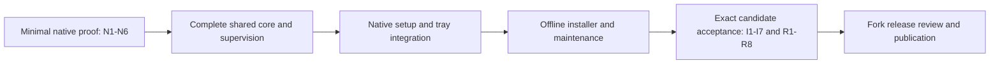

# Native Windows implementation specification and release gates

Status: **approved implementation handoff**, 2026-11-04. The human confirmed the complete specification and planning-map closure on 2026-11-04, including the release-policy choices and the same mandatory bar for public prereleases. All 21 executable gate groups remain PENDING. Approval records a selected route, not native implementation or successful acceptance.

Decision ticket: [Agree the Windows implementation specification and release gates](https://github.com/dapih/Calibre-Web-NextGen/issues/8). Planning map: [Map native Windows installer for Calibre-Web-NextGen](https://github.com/dapih/Calibre-Web-NextGen/issues/1).

This is an implementation handoff. It does not authorize building, publishing or installing the product during this wayfinder effort. No native runtime, installer, migration or device acceptance has passed. The approved browser prototype is interaction evidence only.

## 1. Authority and intended outcome

The first Windows edition is a native, per-user desktop application for Windows 11 on Intel/AMD x64 PCs. One self-contained offline EXE installs the private runtime and tools. CWNG opens its existing web interface in a browser and continues running in the system tray. Users need no Docker, WSL, global Python, compiler, Node, pip or separate tool installation.

These decision records own their detailed behavior; this specification defines implementation boundaries, sequence and evidence rather than replacing them:

| Authority | What it controls |
| --- | --- |
| [First-run, storage and network contract](https://github.com/dapih/Calibre-Web-NextGen/issues/4#issuecomment-6622647229) | Per-user setup, copy import, storage, credentials, local/LAN access and tray lifecycle. |
| [Startup and supervision architecture](https://github.com/dapih/Calibre-Web-NextGen/issues/5#issuecomment-6623576805) | Private CPython, process ownership, portable workflow core, coordinated writes, durable work and six early proof groups. |
| [Installer, upgrade and uninstall contract](https://github.com/dapih/Calibre-Web-NextGen/issues/6#issuecomment-6624310208) | Inno Setup, distribution/update identity, checkpoints, recovery, retention and seven installer evidence groups. |
| [Approved interaction review](https://github.com/dapih/Calibre-Web-NextGen/issues/7#issuecomment-6628686215) | Accepted interaction and all fifteen reviewed scenarios, including failure paths. |
| [Exact reviewed prototype](https://github.com/dapih/Calibre-Web-NextGen/blob/fcc602c213a2f4bab5fb30333ac2e4d1d14a4ceb/docs/install/windows-native-interaction.prototype.html) | A runnable, fictional interaction reference; do not merge or ship its code. Final visual details may change without weakening accepted behavior. |

Supporting investigations are the [runtime research](https://github.com/dapih/Calibre-Web-NextGen/blob/a57a5d822586de61245f6ecbb96f34ff330fd38c/notes/windows-native-runtime-research.md) and [packaging research](https://github.com/dapih/Calibre-Web-NextGen/blob/9c79b9bb8d40f51d862a1f37a9e14480817a60c1/notes/windows-native-packaging-research.md). They inspect source baseline `f342724c25e82bbca580c04786154e0dd71c4811`; artifact availability and source observations are not native execution evidence. Implementation must check drift from that baseline.

A conflict, failed proof or material scope change returns to its owning decision. Do not silently substitute a runtime, omit a required feature or lower the data-preservation contract to make a gate pass.

## 2. First-release scope

| Area | Required behavior |
| --- | --- |
| Main workflows | Library and browser reader; automatic ingest; conversion, including the private tools needed for Kobo/KEPUB; metadata updates and enforcement; OPDS; Kobo and KOReader sync. Each remains required independently of the optional integrations below. |
| Installation | Inno Setup offline EXE, current Windows user, no administrator rights for core installation. Private runtime/tools and isolated tool configuration; no global package/PATH/file-association changes. |
| First run | Local setup creates the first administrator without shared credentials, then chooses a new library or imports a copy of a stopped source library. Validate storage before copying or creating anything. Resume unfinished setup after its window closes. |
| Storage | Separate selectable library and ingest folders on local NTFS, including external NTFS drives; private app state. Ingest is for disposable copies and may consume them only under the verified-outcome contract. |
| Networking | Local-only initially. Explicit home-network consent after account setup; Private-network sharing only, with separate local/device addresses and connection checks. Declined or failed firewall permission keeps local use available. |
| Tray | Responsive status, open-library, start/stop, data locations, diagnostics, LAN settings, optional login startup, updates and Exit. Browser close leaves CWNG running; duplicate launch reuses the existing instance. Login startup begins off. |
| Maintenance | Cooperative stop and exclusive ownership through checkpoint/migration/validation/activation. User chooses when to download and run an update. Default uninstall retains data; separately confirmed optional app-state reset preserves protected content. |
| Distribution | Clearly identified `dapih/Calibre-Web-NextGen` releases and native update feed. Stable default, prereleases opt-in, one active version per Windows account. Unsigned stable releases are allowed. |

Explicit exclusions: Windows 10 and ARM64; an always-on/pre-login Windows service; a new native reader; full Docker/CWNG state migration; opening an existing Calibre library in place or sharing it live with Calibre desktop; NAS/network shares and cloud-synced data folders. Managed Calibre Content Server, LDAP login and Book Sources acquisition are deferred native integrations. Disable and explain those three in native mode; do not remove them from Docker.

Internet-dependent features may need internet access during use. Offline installation, administrator setup, local reading, local ingest/conversion/enforcement and local device networking must not depend on a WAN connection or dependency download. Unavailable external metadata services must report their failure without blocking unrelated local workflows.

## 3. Implementation boundaries and invariants

| Boundary | Responsibilities and required contract |
| --- | --- |
| Native entrypoint/helper | Initialize private runtime/DLL lookup before application imports; report missing/broken runtime; provide creation-time Job Object containment and low-level Windows ownership/lifecycle facilities. Runs in the Python controller host; no private .NET runtime is selected. |
| Python tray/controller | Authoritative profile ownership for the supported per-user installation; private IPC; authenticated activation; startup/readiness; worker supervision; write-lease authority; durable ledger; maintenance handoff and old-generation fencing. Keep supervision/storage work off the tray message loop. |
| Web process | Existing production HTTP stack, library/device endpoints, existing in-app scheduler and task executors. Register its book-changing operations with shared coordination and the ledger. Disable development reloaders, unmanaged self-reexec and the source-ZIP updater in native mode. |
| Automation dispatcher | Observe before initial ingest scan/drain; admit stable inputs; dispatch pending/retry work; preserve metadata quiet-period and busy-timer behavior; own external maintenance scheduling exactly once under the architecture's task ownership assignment. Begin with replaceable portable polling. |
| Portable workflow core | Shared Windows/Docker workflow policy: stable-file admission, debounce, retries/deadlines, deduplication, post-batch follow-up and job transitions. Importing it must not inadvertently start Flask. Extract incrementally from Linux shell orchestration with regression coverage. |
| OS adapters and jobs | Paths/permissions, watching, locks, durable filesystem operations, child launch, process-tree cleanup and lifecycle notifications. Short-lived jobs/tools use explicit private executables and environments. Linux keeps s6 supervision and its platform semantics. |
| Installer/maintenance layer | Complete versioned payload staging, stable activation identity, cooperative exclusive handoff, recovery journals, gated migrations and precise manifest-owned uninstall. Inno supplies packaging primitives; CWNG owns data coherence and recovery. |

The following are non-negotiable implementation invariants:

1. Establish private imports, executable resolution and DLL policy in every entrypoint and helper. Absolute paths and process-local environments keep CWNG, Calibre and ImageMagick resource/DLL trees separate. Give tools app-owned config/cache/temp paths. Host Python, user-site, CWD modules, global Calibre profiles/plugins and inherited tool variables must not redirect execution. Dependency isolation is not a security sandbox against the owning Windows user.
2. Acquire one authoritative profile lock for the supported per-user installation. Authenticate the existing instance through the restricted local named pipe; keep control local. Verify owned-process readiness and library identity. An open port is not proof of identity or readiness.
3. Use native creation-time association with Windows Job Objects before a child can execute. Keep the browser/controller outside worker jobs; prevent unwanted job-handle inheritance. Journal a generation before launch and retain authoritative process/job identity. On restart, fence writes until old mutating descendants are verified quiescent. Uncertain ownership pauses work; never kill by executable name or unverified PID text.
4. Serialize background book-changing jobs initially. Coordinate every web, scheduler, tool and maintenance writer too. Maintain the documented lock order and keep a controller-owned write lease until the operation and mutating descendants are quiescent. Caller death is not proof that a raw Calibre transaction ended. Missing/unsupported coordination prevents mutation.
5. Make recoverable intent durable before acknowledging work. The private versioned SQLite ledger records jobs, attempts, ownership and reconciliation. It is not a transaction across the ledger, Calibre DB and book files. Reconcile interrupted outcomes before retry; ambiguous outcomes retain inputs and pause for review. Remove an input only after confirmed commit or a verified retained copy justifies removal, including failed-backup and timeout paths.
6. Run no ordinary library jobs/routes before administrator/location setup and no ordinary mutations during recovery, maintenance, migrations or validation. Account for database constructors/startup jobs that can migrate or write implicitly.
7. Default worker recovery is three restarts per failed role in five minutes, with 2/10/30-second delays. Persistent faults pause affected work; configuration/dependency/ownership/storage failures wait for correction. Controller failure stops owned trees; the next user launch recovers. No extra watchdog/service is selected. Measure startup/heartbeat budgets during proof and distinguish liveness, readiness and job progress.
8. Handle Stop/Exit with Finish current book (default), Stop safely and retry later, or Keep running. Retain unresolved intent through forced OS shutdown, suspend and power loss; do not depend on finishing within an OS notification window. Recheck storage, ownership, workers and network on resume. A missing/replaced drive must never cause an empty fallback library.
9. Keep setup and local account recovery separate from LAN-exposed operational routes. Recover the owning user's credentials without deleting books/accounts/progress, pause LAN access and explain client reauthentication. Never expose passwords/control secrets in URLs or logs.

## 4. Paths, payload and compatibility records

| Role | Agreed location/policy |
| --- | --- |
| Program | `%LOCALAPPDATA%\Programs\CWNG-dapih`; stable launcher/activation record and complete versioned payload directories. No persistent app data in code or temporary extraction trees. |
| Private state | `%LOCALAPPDATA%\CWNG`; accounts/settings, progress/pairings, encryption material, automation/history/ledger and explicitly inventoried writable tool state. |
| Book defaults | `%USERPROFILE%\CWNG\Library` and `%USERPROFILE%\CWNG\Ingest`; independently selectable supported folders, never overlapping each other or private state. |
| Recovery | `%LOCALAPPDATA%\CWNG-Recovery`, outside source trees, or another validated local NTFS destination. Keep keys/private ACLs and the matching payload identity. |
| Diagnostics | Proposed `%LOCALAPPDATA%\CWNG\logs`, discoverable/openable from tray controls. Redact secrets and make component/failure/recovery action clear. |

Use one runtime/path descriptor across web, automation and helpers. Inventory the resolved persistent paths and protected content, including content nested inside private state. Canonicalization must handle aliases/reparse points consistently. Validate write access, free space, eligible filesystem and non-overlap before work. Reject source/destination overlap in copy import, runtime/program trees as book/ingest destinations, and checkpoints nested in their source trees. Do not treat an occupied or foreign/actively owned library as an empty new destination; enforce the copy-only, no-live-sharing boundary. Reject deferred locations with an actionable explanation. Record supported path-length limits and test long paths within those limits without requiring an unadvertised administrator configuration change.

The release/build manifest must record: fork/distribution identity and stable AppId; application version and Windows package revision; source commit; channel/x64 architecture; supported/tested OS builds and security policies; hashes/origins for every artifact; Python/PBS/native-helper/build-tool identities; locked direct/transitive dependencies; static/frontend/translation/plugin resources; private tool/resource paths; capability/format matrix; state/library schema compatibility; supported predecessor packages; migration IDs/change inventory/required checkpoint scope; installer disk/temporary space requirements; and notices/corresponding-source/build-material locations.

Explicit payload closure includes CPython and native extensions, the private faust wheel, a deliberate compatible `magic` wrapper/DLL/database selection, complete private Calibre, kepubify, ImageMagick/Wand DLLs/resources/delegates, required archive/MIME backends and any justified app-local redistributables. Include built SPA/classic assets/templates/SQL/resources/fonts/reader assets, compiled translations and the generated KOReader plugin ZIP. A package lock or executable version check alone does not prove closure. Inventory exact redistribution obligations and build/source material before publication; defer no required runtime file to an end-user download.

Exact serviced versions, hashes, compiler flags, native binding details, schema layouts and startup/heartbeat thresholds are implementation outputs subject to the approved constraints and gates. They are not permission to change the selected architecture. Any system prerequisite or app-local redistributable must be explicitly justified in the payload review; a separate global runtime installer conflicts with the offline/per-user contract.

## 5. Ordered implementation handoff

| Milestone | Work boundary and exit condition |
| --- | --- |
| M0 — native proof | In an isolated implementation branch, build the smallest disposable runtime/helper/adapter/pipeline harness needed for N1-N6. Include the faust build and actual tools. Test crash/coordination/queue behavior, not just imports. All six groups must pass before committing to the complete installer/release payload. Failures reopen the affected decision. |
| M1 — complete core and supervision | Finish the portable extraction, native ledger and writer audit, private bootstrap/IPC, process ownership, scheduling and lifecycle controls. Produce a writer/child/lock inventory and deterministic fault-injection fixtures. Preserve the established proof evidence or rerun it when affected. |
| M2 — setup and tray | Implement the approved administrator/library/copy-import flow, storage eligibility/recovery, local and LAN status/consent, port persistence, settings, capability limitations and all fifteen interaction scenarios. Keep controls responsive and recovery local/private. |
| M3 — installer and maintenance | Author the complete Inno package and fork manifest/update path. Implement exclusive maintenance, checkpoints, versioned migrations/activation journal, rollback/restore limits, same-version repair and exact uninstall/reset retention. Pass I1-I7 against real packages. |
| M4 — candidate acceptance | Produce an immutable candidate and run complete R1-R8 acceptance plus all applicable N/I groups against its exact bits. Finish Windows installation/help/update/recovery documentation and relevant portable regression evidence runnable in the available environment. A development checkout, prototype or CI runner alone is insufficient. |
| M5 — publication | The fork's release-maintaining team verifies evidence, issues the release decision and publishes the EXE/feed/verification/source material. Record candidate identity and any cosmetic limitations. Publication remains a separate action from agreeing this specification. |

Do not create or execute these implementation tasks as a side effect of closing this planning ticket. The next authorized implementation effort should start at M0 and use this specification as its acceptance contract.

## 6. Mandatory early native proof

These preserve the six groups from the startup architecture. A failed/unknown result blocks downstream installer/payload commitment. Use disposable libraries and deterministic fixtures; no user collection is a crash-test fixture. Validate the supported per-user installation and ordinary duplicate launches using the available Windows account. Another account, session, machine or VM is outside this validation scope. Docker and WSL are not required and must not be installed or enabled for these checks.

| Gate | Required demonstration and pass condition | Evidence | Status |
| --- | --- | --- | --- |
| N1 — private M0 closure | Reproducibly build the approved faust wheel; resolve compiled imports and `magic` ownership; exercise MIME/Wand, the private tools and assets used by the minimal M0 pipeline. With conflicting tool lookup entries, poisoned Python/tool/Qt/ImageMagick variables and an unrelated CWD, check the actual web, ingest and enforcement workers and their principal tools use private artifacts or Windows facilities. Check relevant persistent host settings are unchanged. The eventual package must not require an end-user compiler or pip. Failed faust/import/encoding behavior requires a dependency decision. Complete optional-feature, package and redistribution review remains in the later release gates. | Locked inventory/hashes/build logs; worker and tool origin snapshots; encoding/metadata checks; scoped before/after host audit. | PASS |
| N2 — ownership/control/readiness | A standard-user duplicate launch reuses the existing owner and cannot create a conflicting owner. Authenticate pipe peers and owned readiness, reject remote control, gate first-run jobs, handle occupied ports without adoption/termination, and keep local control separate from LAN. | Duplicate-launch, local control and port-conflict results; owned-process/readiness traces. | PASS |
| N3 — child containment and old-run fencing | Prove atomic job membership before child execution. Crash the controller at each launch phase; exercise parent-only death, children/grandchildren, inherited/leaked handles and ordinary same-user relaunch. Verify old trees are quiescent before new writes and unrelated applications remain untouched. Uncertainty stops startup instead of guessing. | Fault-injection points and process/job traces; handle/identity checks; post-crash write-admission assertions. | PASS |
| N4 — all-writer exclusion | Audit supported in-app library mutation paths and test ingest, web metadata/cover edits, conversion and maintenance concurrently. Interrupt a caller while its raw mutating child still runs, then crash/relaunch the controller. No overlapping lease/transaction, early release or uncoordinated mutation; unsupported native operations and backend locks reject writes. Third-party applications and plugins are outside the per-user app coordination boundary. | Source writer/child/lock-order inventory; concurrency timelines and DB/file integrity results. | PASS |
| N5 — durable work and lifecycle | Slow-copy admission, observe-before-scan startup, pending work after restart, metadata debounce without later events, busy retries, timeout/failed-backup/disk-full retention, deduplication/reconciliation, restart exhaustion, Stop/Exit and Windows suspend or unavailable storage all preserve committed books and unresolved inputs. Ambiguous outcomes pause for review. Exercise notifications and storage loss locally without requiring physical devices or system setup. | Job/ledger and input/retained-copy manifests across failure boundaries; retry/state traces; restart-budget and lifecycle results. | PASS |
| N6 — shared core and native pipeline | Pass relevant portable regressions runnable in the available environment and demonstrate a minimal complete native ingest → conversion → metadata enforcement → persistence/restart pipeline with private tools. Verify new state versus a copied stopped-source library. This does not replace full packaged-reader or physical-device release tests. | Commands/results at source commit; disposable fixture hashes/expected output; Windows and applicable portable-check logs. | PASS |

## 7. Installer evidence — all pending

These preserve all seven installer evidence groups, after N1-N6. Test real installer/uninstaller/repair/update packages and failure re-entry; Inno transaction completion is not evidence of application-data rollback.

| Gate | Required demonstration and pass condition | Status |
| --- | --- | --- |
| I1 — clean offline installation | A standard user on Windows 11 x64 installs from one offline EXE in an isolated per-user installation and completes first launch with WAN unavailable. Complete private frontend/runtime/tool assets, correct distribution/AppId/shortcuts/uninstall registration and accurate unsigned status; no global environment/association changes. Reject unsupported architecture/OS or unusable locations before destructive changes. | PENDING |
| I2 — compatible user-controlled maintenance | Same-AppId upgrades and same-version repair, stable/prerelease transitions, busy/cancel choices and maintenance re-entry obey ownership and compatibility rules. Check only the configured fork's selected-channel manifest; validate source/asset/version/arch/hash, reject missing/mismatched data and direct downgrades. At-most-daily checks, Check now and disable-checks work; no automatic download/install, source-ZIP native update or forced silent shutdown. Offline manual update works. | PENDING |
| I3 — checkpoint/migration coverage | Before new-version code can implicitly migrate, stop all writers and capture/verify complete private state plus library DB/covered files, keys and ledger coherently, including WAL handling. Suppress constructors/scheduled/user mutations through validation. File-changing or uncertain coverage requires a coherent full state-and-library snapshot; insufficient coverage stops the update. | PENDING |
| I4 — interruption and unavailable storage | Inject interruption and disk-full/missing/replaced-drive failures at staging, checkpoint, migration, activation and re-entry boundaries. Journals select verified payload/data or keep work stopped. Pre-mutation checkpoint failure leaves the old coherent installation usable. Never delete protected content for space or create a fallback library. | PENDING |
| I5 — correct recovery limits | Demonstrate covered pre-resume restoration with matching old payload/checkpoint, and separately a post-resume guided restore with explicit consequence acceptance and coherent full coverage when book files changed. Reconcile current actual ingest files against restored intent; consumed files do not reappear. Preserve keys/DBs/assets coherence, fresh run authority and external maintenance guard. Retain last two verified routine checkpoints, protecting unresolved-failure/user/full backups. No DB reconstruction or binary-only downgrade as rollback. | PENDING |
| I6 — exact uninstall/reset/reinstall | Default uninstall removes owned program/runtime/integration records and retains all user data. The initially unchecked reset requires a separate summary/confirmation, deletes only inventoried accounts/settings/progress/pairings/intent/obsolete secrets and preserves library/ingest, backups, originals/failed books and custom assets even inside private state. Test aliases/reparse points and cancellation. Retained-state reinstall checks compatibility; reset reinstall uses fresh setup/copy policy without overwriting retained books or replaying old authority. No broad recursive state-root deletion. | PENDING |
| I7 — actual artifact trust/policy behavior | Test the exact unsigned Setup, native entrypoints and uninstaller on the advertised Windows builds/security-policy baseline; record warnings/blocks and verification/source instructions accurately. No security-setting bypass. Unsigned stable publication remains allowed. If signing is later introduced, separately verify integrated signatures/coverage while preserving upstream signatures; signing is not a first-release gate. | PENDING |

## 8. Complete candidate acceptance — all pending

| Gate | Required outcome | Status |
| --- | --- | --- |
| R1 — packaged library/reader/assets | From the installed candidate, create a new library and import a copy of a stopped source; confirm source hashes/metadata unchanged and fresh CWNG accounts/progress/pairings. Exercise authenticated browsing, searching, metadata/cover edits, downloads and representative EPUB/PDF/comic reading in every advertised format. SPA/classic routes, images/fonts/reader resources, translations and KOReader ZIP load from the package with WAN unavailable. An incomplete copy is recoverable, never ready. | PENDING |
| R2 — production automation/tools | End-to-end startup pending ingest, slow files, conversion/KEPUB, metadata update followed by enforcement without a later event, retries/originals/failed books and restart persistence. Compare database and book-file results, metadata/cover output and queue/source retention. Exercise every advertised native conversion/archive/format backend, not just tool version commands. Scheduled maintenance runs once under its intended owner. | PENDING |
| R3 — local and LAN/authentication | First-run admin/recovery works offline, shared defaults are absent and secrets stay private. Local-only listener configuration is verified on the available Windows host. LAN opt-in, declined elevation, Private/Public profile/address changes, port conflict/retry/change and reachable device URLs behave as agreed. OPDS authentication/catalog/cover/acquisition succeeds over LAN; local control/recovery never becomes a device endpoint. | PENDING |
| R4 — actual e-readers | Use at least one real Kobo and one real KOReader device; record model, firmware/app/plugin versions. Verify pairing, first/incremental sync, book delivery/KEPUB where applicable, progress/annotations and continuity across restart, with browser/local use still working. Emulation/unit tests supplement but do not replace physical-device acceptance. Advertise only the tested compatibility; failures cannot be relabelled optional. | PENDING |
| R5 — paths/storage boundaries | Test spaced/Unicode user/install paths, selected NTFS folders, supported long paths, standard-user permissions, non-overlap including aliases/reparse points, external drive removal/replacement/return and read-only/full destinations. No original loss, unintended path writes or empty-library substitution. Reject/defer network/non-NTFS/cloud-synced locations consistently and document eligibility/path-length limits. | PENDING |
| R6 — installed lifecycle and all reviewed interactions | Run all fifteen approved prototype scenarios against the real installed product, plus quiet opt-in login startup, Explorer/tray restart, ordinary duplicate launch, stop/start, logoff, sleep/resume and forced termination. Show correct readiness/paused/error state, data/log entry points and pending-work results. Tray stays responsive during long tool jobs; worker budgets and quiescence remain correct. | PENDING |
| R7 — portable regression | Run relevant repository checks for extracted workflows, writer/locking/queue behavior, startup, conversion/metadata, OPDS/Kobo/KOReader and affected web paths. Preserve existing container defaults and optional capabilities in the implementation; Docker deployment testing is not required for this Windows work. Record baseline failures separately; newly introduced regressions block completion. Native flags/adapters do not change container defaults or import startup behavior. | PENDING |
| R8 — release completeness and servicing | Re-run candidate identity/isolation and affected N/I checks against the exact release build; complete dependency/security/license/source inventory and supported Windows/device/policy matrix. Ship install/update/recovery/uninstall help and an assistant setup path distinguishing native Windows from Docker/WSL. Document internet needs, copy-migration limits, storage exclusions and deferred integrations. Publish only matching EXE/manifest/hash/source/provenance material and fork identity. | PENDING |

Use the available Windows 11 x64 user account and ordinary duplicate launches. Use isolated per-user paths, disposable data and controlled environment overrides when needed. No test requires another account, logon session, machine or VM, or installing or enabling Docker or WSL.

## 9. Confirmed release policy and evidence handling

Confirmed in this ticket's discussion:

- **Windows support baseline:** each stable release names serviced Windows 11 x64 versions/builds actually tested, including relevant edition/security-policy configuration. Document policy configurations that block an unsigned package as unsupported for that package; do not tell users to weaken Windows protections. This preserves unsigned stable releases as an allowed distribution choice.
- **Dependency servicing:** start M0 from the approved repository/runtime pins. Before stable release, lock and review the actual payload for support status/security fixes and rerun affected compatibility checks after version changes. Record unresolved findings and their assessment. Findings that undermine promised isolation, authentication or data safety block stable release. Material runtime/dependency changes reopen their design decision.

For every N/I/R gate, maintain a release evidence record with: gate/subcase; PENDING/PASS/FAIL/BLOCKED; tester/date; source commit and installer/payload hashes; exact OS/build/policy and devices; fixtures/commands/fault points; expected versus observed result; logs/traces/before-after inventories; known limitations; and linked defect or decision if failed. Preserve enough sanitized evidence to reproduce the result without exposing real books, credentials or reading annotations.

PENDING means not executed; BLOCKED means a missing prerequisite; neither counts as PASS. An optional signed-package check can be marked not applicable with a reason when signing is absent; I7's unsigned-policy checks remain mandatory. Deferred integrations cannot excuse a required workflow. Do not waive a mandatory gate by listing it as a known issue.

All six native proof groups, all seven applicable installer groups and complete candidate acceptance must pass for stable publication. Public native prereleases use the same mandatory bar; a prerelease label does not waive a failed gate. Proofs use disposable data. The user explicitly authorized pushing the M0 source branch; that does not authorize publication of experimental binary wheels or an installer. A different public-test policy requires a separate explicit decision. Evidence from an earlier package is reusable only with a recorded change-impact explanation; changes affecting a gate require it to run again. Carry failures forward until resolved and run relevant portable checks available in the existing environment after shared-core changes.

The fork release-maintaining team owns the stable release decision. It reviews the exact candidate and evidence, verifies the manifest/source/checksum/provenance and supported-policy documentation, and records the publication verdict. Signing identity/country remains deferred. No schedule, payload-size promise, broad Windows/device compatibility or production-readiness claim is made before evidence exists.

## 10. Remaining assumptions and completion of this map

| Item | Current state and disposition |
| --- | --- |
| Product/install/interaction choices | Approved in the linked authoritative tickets. |
| Tested-build policy and dependency servicing | Confirmed in this ticket's discussion. |
| Private PBS/faust/native DLL/tool closure | N1 passes for the minimal local M0 pipeline; exact package and release closure remain later gates. |
| Atomic Job Object launch, named-job recovery, IPC/per-user ownership and writer coordination | N2–N4 pass their local M0 proofs; production launcher and maintenance integration remain later work. |
| Durable queues and preserved workflow/Linux behavior | N5–N6 pass their local M0 proofs; later full regression gates remain. |
| Real maintenance/installer/data recovery | Unvalidated; I1-I7 block release. |
| Packaged workflows, physical e-readers and advertised support matrix | Unvalidated; R1-R8 block release. |
| Exact versions/schema/format inventory/budgets/build sizes | Implementation outputs that must be explicit and verified before their consuming gate; no silent new prerequisites or scope changes. |

The human confirmed the planning handoff and release bar on 2026-11-04. The M0 proof results above do not establish a completed installer or release.

Retain this specification at an immutable commit linked from the resolution and map. Implementation begins only in a subsequent authorized effort, starting at M0. A failed proof or newly discovered design dependency reopens the relevant decision; it does not get hidden inside a lower release bar.
