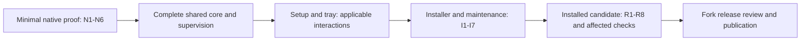

# Native Windows implementation specification and release gates

Status: **M0 proof complete; M1 in progress; M2–M5 pending**, 2026-11-06. The human approved the original implementation handoff on 2026-11-04, including the release-policy choices and the same mandatory bar for public prereleases. N1–N6 now pass within the local M0 scope; the fifteen installer/candidate groups I1–I7 and R1–R8 remain PENDING. See the [M0 handoff](windows-m0-handoff.md), [progress record](windows-m0-progress.md) and [writer inventory](windows-m0-writer-inventory.md) for evidence and limits.

Decision ticket: [Agree the Windows implementation specification and release gates](https://github.com/dapih/Calibre-Web-NextGen/issues/8). Planning map: [Map native Windows installer for Calibre-Web-NextGen](https://github.com/dapih/Calibre-Web-NextGen/issues/1).

This is the current implementation contract, including the 2026-11-06 simplifications below. M0 establishes native proof behavior, not installer, migration or physical-device acceptance. The approved browser prototype remains an interaction reference. Publication is a separate action.

## 1. Authority and intended outcome

The first Windows edition is a native, per-user desktop application for Windows 11 on Intel/AMD x64 PCs. One self-contained offline EXE installs the private runtime and tools. CWNG opens its existing web interface in a browser and continues running in the system tray. Users need no Docker, WSL, global Python, compiler, Node, pip or separate tool installation.

These historical decision records explain the selected behavior. This specification carries the current implementation sequence and evidence requirements; section 5 records the simplifications made during this review. The product scope and data-preservation requirements remain in force.

| Authority | What it controls |
| --- | --- |
| [First-run, storage and network contract](https://github.com/dapih/Calibre-Web-NextGen/issues/4#issuecomment-6622647229) | Per-user setup, copy import, storage, credentials, local/LAN access and tray lifecycle. |
| [Startup and supervision architecture](https://github.com/dapih/Calibre-Web-NextGen/issues/5#issuecomment-6623576805) | Private CPython, process ownership, portable workflow core, coordinated writes, durable work and six early proof groups. |
| [Installer, upgrade and uninstall contract](https://github.com/dapih/Calibre-Web-NextGen/issues/6#issuecomment-6624310208) | Inno Setup, distribution/update identity, checkpoints, recovery, retention and seven installer evidence groups. |
| [Approved interaction review](https://github.com/dapih/Calibre-Web-NextGen/issues/7#issuecomment-6628686215) | Accepted outcomes of fifteen scenarios, including failure paths; section 5 assigns each to its implementation and acceptance work. |
| [Exact reviewed prototype](https://github.com/dapih/Calibre-Web-NextGen/blob/fcc602c213a2f4bab5fb30333ac2e4d1d14a4ceb/docs/install/windows-native-interaction.prototype.html) | A runnable, fictional interaction reference; do not merge or ship its code. Final visual details may change without weakening accepted behavior. |

Supporting investigations are the [runtime research](https://github.com/dapih/Calibre-Web-NextGen/blob/a57a5d822586de61245f6ecbb96f34ff330fd38c/notes/windows-native-runtime-research.md) and [packaging research](https://github.com/dapih/Calibre-Web-NextGen/blob/9c79b9bb8d40f51d862a1f37a9e14480817a60c1/notes/windows-native-packaging-research.md). They inspect source baseline `f342724c25e82bbca580c04786154e0dd71c4811`; artifact availability and source observations are not native execution evidence. Implementation must check drift from that baseline.

A conflict, failed proof or material scope change returns to its owning decision. Do not silently substitute a runtime, omit a required feature or lower the data-preservation contract to make a gate pass.

## 2. First-release scope

| Area | Required behavior |
| --- | --- |
| Main workflows | Library and browser reader; automatic ingest; conversion, including the private tools needed for Kobo/KEPUB; metadata updates and enforcement; OPDS; Kobo and KOReader sync. Each remains required independently of the optional integrations below. |
| Installation | Inno Setup offline EXE, current Windows user, no administrator rights for core installation. Private runtime/tools and isolated tool configuration; no global package/PATH/file-association changes. |
| First run | Local setup creates the first administrator without shared credentials, then chooses a new library or imports a copy of a stopped source library. Validate storage before copying or creating anything. Resume unfinished setup after its window closes. |
| Storage | Separate selectable library and ingest folders on local NTFS, including external NTFS drives; private app state. Ingest is for disposable copies and may consume them only under the verified-outcome contract. |
| Networking | Local-only initially. Explicit home-network consent after account setup; Private-network sharing only, with separate local/device addresses and connection checks. Declined or failed firewall permission keeps local use available. |
| Tray | Responsive status, open-library, start/stop, data locations, diagnostics, LAN settings, optional login startup, updates and Exit. Browser close leaves CWNG running; duplicate launch reuses the existing instance. Login startup begins off. |
| Maintenance | Cooperative stop and exclusive ownership through checkpoint/migration/validation/activation. User chooses when to download and run an update. Default uninstall retains data; separately confirmed optional app-state reset preserves protected content. |
| Distribution | Clearly identified `dapih/Calibre-Web-NextGen` releases and native update feed. Stable default, prereleases opt-in, one active version per Windows account. Unsigned stable releases are allowed. |

Explicit exclusions: Windows 10 and ARM64; an always-on/pre-login Windows service; a new native reader; full Docker/CWNG state migration; opening an existing Calibre library in place or sharing it live with Calibre desktop; NAS/network shares and cloud-synced data folders. Managed Calibre Content Server, LDAP login and Book Sources acquisition are deferred native integrations. Disable and explain those three in native mode; do not remove them from Docker.

Internet-dependent features may need internet access during use. Offline installation, administrator setup, local reading, local ingest/conversion/enforcement and local device networking must not depend on a WAN connection or dependency download. Unavailable external metadata services must report their failure without blocking unrelated local workflows.

**Current native limitation:** the native launcher serves HTTP only; home-network HTTP is unencrypted and consent must explain that. Native LDAP and OAuth login are unavailable: LDAP is a deferred integration, while OAuth also requires secure cookies that the HTTP listener cannot provide reliably on a device address. Native settings reject unsupported certificate, key, secure-cookie and LDAP/OAuth choices instead of silently changing them; saved incompatible settings stop startup with an explanation. Before advertising native HTTPS or OAuth, provide consistent TLS for local and LAN listeners, certificate validation and scheme-aware readiness/device URLs, then verify secure-cookie login and recovery. This limitation does not alter the container.

## 3. Implementation boundaries and invariants

| Boundary | Responsibilities and required contract |
| --- | --- |
| Native entrypoint/helper | Initialize private runtime/DLL lookup before application imports; report missing/broken runtime; provide creation-time Job Object containment and low-level Windows ownership/lifecycle facilities. Runs in the Python controller host; no private .NET runtime is selected. |
| Python tray/controller | Authoritative profile ownership for the supported per-user installation; private IPC; authenticated activation; startup/readiness; worker supervision; write-lease authority; durable ledger; maintenance handoff and old-generation fencing. Keep supervision/storage work off the tray message loop. |
| Web process | Existing production HTTP stack, library/device endpoints, existing in-app scheduler and task executors. Synchronous edits hold shared writer coordination through commit/publication; queued work uses durable intent. Do not add a ledger job around every synchronous edit. Disable development reloaders, unmanaged self-reexec and the source-ZIP updater in native mode. |
| Automation dispatcher | Observe before initial ingest scan/drain; admit stable inputs; dispatch pending/retry work; preserve metadata quiet-period and busy-timer behavior; own external maintenance scheduling exactly once under the architecture's task ownership assignment. Reuse the proven native watcher and periodic rescan; no replacement polling implementation is required. |
| Portable workflow core | Share workflow policy where Windows and Docker actually need the same behavior: stable-file admission, debounce, retries/deadlines, deduplication, post-batch follow-up and job transitions. Importing it must not inadvertently start Flask. Extract incrementally when integration requires it, with focused regression coverage; M1 does not require a general scheduler framework or wholesale Linux shell rewrite. |
| OS adapters and jobs | Paths/permissions, watching, locks, durable filesystem operations, child launch, process-tree cleanup and lifecycle notifications. Short-lived jobs/tools use explicit private executables and environments. Linux keeps s6 supervision and its platform semantics. |
| Installer/maintenance layer | Complete versioned payload staging, stable activation identity, cooperative exclusive handoff, recovery journals, gated migrations and precise manifest-owned uninstall. Inno supplies packaging primitives; CWNG owns data coherence and recovery. |

The following are non-negotiable implementation invariants:

1. Establish private imports, executable resolution and DLL policy in every entrypoint and helper. Absolute paths and process-local environments keep CWNG, Calibre and ImageMagick resource/DLL trees separate. Give tools app-owned config/cache/temp paths. Host Python, user-site, CWD modules, global Calibre profiles/plugins and inherited tool variables must not redirect execution. Dependency isolation is not a security sandbox against the owning Windows user.
2. Acquire one authoritative profile lock for the supported per-user installation. Authenticate the existing instance through the restricted local named pipe; keep control local. Verify owned-process readiness and library identity. An open port is not proof of identity or readiness.
3. Associate controller-managed workers with Windows Job Objects at creation, before they can execute. Keep the browser/controller outside worker jobs; prevent unwanted job-handle inheritance. Journal a generation before launch and retain authoritative process/job identity. On restart, fence writes until old mutating descendants are verified quiescent. Uncertain ownership pauses work; never kill by executable name or unverified PID text.
4. Serialize background book-changing jobs initially. Coordinate every web, scheduler, tool and maintenance writer too. Maintain the documented lock order. A synchronous writer holds the shared gate through commit/publication, retains its transaction/staging recovery and must not leave a child able to mutate the library after release. A controller-managed job retains its lease until mutating descendants are quiescent. A child operating only on private staging may outlive its parent if it cannot publish to the library. Caller death is not proof that a raw Calibre transaction ended. Missing/unsupported coordination prevents mutation.
5. Make queued/retryable intent durable before acknowledging its acceptance. The private versioned SQLite ledger records jobs, attempts, ownership and reconciliation; ordinary synchronous web edits need no separate durable job when invariant 4 is satisfied. The ledger is not a transaction across itself, Calibre DB and book files. Reconcile interrupted outcomes before retry; ambiguous outcomes retain inputs and pause for review. Remove an input only after confirmed commit or a verified retained copy justifies removal, including failed-backup and timeout paths.
6. Run no ordinary library jobs/routes before administrator/location setup and no ordinary mutations during recovery, maintenance, migrations or validation. Account for database constructors/startup jobs that can migrate or write implicitly.
7. Default worker recovery is three restarts per failed role in five minutes, with 2/10/30-second delays. Persistent faults pause affected work; configuration/dependency/ownership/storage failures wait for correction. Controller failure stops owned trees; the next user launch recovers. No extra watchdog/service is selected. Measure startup/heartbeat budgets during proof and distinguish liveness, readiness and job progress.
8. Handle Stop/Exit with Finish current book (default), Stop safely and retry later, or Keep running. Retain unresolved intent through forced OS shutdown, suspend and power loss; do not depend on finishing within an OS notification window. Recheck storage, ownership, workers and network on resume. A missing/replaced drive must never cause an empty fallback library.
9. Keep setup and local account recovery separate from LAN-exposed operational routes. Recover the owning user's credentials without deleting books/accounts/progress, pause LAN access and explain client reauthentication. Never expose passwords/control secrets in URLs or logs.

## 4. Paths, payload and compatibility records

| Role | Agreed location/policy |
| --- | --- |
| Program | `%LOCALAPPDATA%\Programs\CWNG-dapih`; stable launcher/activation record and complete versioned payload directories. No persistent app data in code or temporary extraction trees. |
| Private state | `%LOCALAPPDATA%\CWNG`; accounts/settings, progress/pairings, encryption material, automation/history/ledger and explicitly inventoried writable tool state. |
| Book defaults | `%USERPROFILE%\CWNG\Library` and `%USERPROFILE%\CWNG\Ingest`; independently selectable supported folders, never overlapping each other or private state. |
| Recovery | `%LOCALAPPDATA%\CWNG-Recovery`, outside source trees, or another validated local NTFS destination. Keep keys/private ACLs and the matching payload identity. |
| Diagnostics | Proposed `%LOCALAPPDATA%\CWNG\logs`, discoverable/openable from tray controls. Redact secrets and make component/failure/recovery action clear. |

Use one runtime/path descriptor across web, automation and helpers. Inventory the resolved persistent paths and protected content, including content nested inside private state. Canonicalization must handle aliases/reparse points consistently. Validate write access, free space, eligible filesystem and non-overlap before work. Reject source/destination overlap in copy import, runtime/program trees as book/ingest destinations, and checkpoints nested in their source trees. Do not treat an occupied or foreign/actively owned library as an empty new destination; enforce the copy-only, no-live-sharing boundary. Reject deferred locations with an actionable explanation. Record supported path-length limits and test long paths within those limits without requiring an unadvertised administrator configuration change.

Separate information by consumer without requiring separate files or new manifest schemas. The update feed needs only fork/distribution identity, version/package revision, channel, architecture/OS eligibility, installer URL and hash. The installed package needs AppId, payload identity, paths/capabilities, schema/predecessor compatibility, actual migration/checkpoint scope and disk/temporary-space requirements. Build/release evidence retains the source commit, artifact hashes/origins, runtime/helper/build-tool identities, dependency lock, bundled asset inventory, tested OS/security-policy matrix and notices/source/build-material locations. The update checker does not need to fetch or validate the full dependency/build inventory. Generate shared data once and check it where it is consumed.

Explicit payload closure includes CPython and native extensions, the private faust wheel, a deliberate compatible `magic` wrapper/DLL/database selection, complete private Calibre, kepubify, ImageMagick/Wand DLLs/resources/delegates, required archive/MIME backends and any justified app-local redistributables. Include built SPA/classic assets/templates/SQL/resources/fonts/reader assets, compiled translations and the generated KOReader plugin ZIP. A package lock or executable version check alone does not prove closure. Inventory exact redistribution obligations and build/source material before publication; defer no required runtime file to an end-user download.

Exact serviced versions, hashes, compiler flags, native binding details, schema layouts and startup/heartbeat thresholds are implementation outputs subject to the approved constraints and gates. They are not permission to change the selected architecture. Any system prerequisite or app-local redistributable must be explicitly justified in the payload review; a separate global runtime installer conflicts with the offline/per-user contract.

## 5. Ordered implementation handoff

| Milestone | Work boundary and exit condition |
| --- | --- |
| M0 — native proof | In an isolated implementation branch, build the smallest disposable runtime/helper/adapter/pipeline harness needed for N1-N6. Include the faust build and actual tools. Test crash/coordination/queue behavior, not just imports. All six groups must pass before committing to the complete installer/release payload. Failures reopen the affected decision. |
| M1 — integrate proven core and supervision | Integrate the M0 bootstrap/IPC, ledger, job ownership, writer gate, scheduler and lifecycle handling into the normal launcher. Complete application-wide readiness, worker supervision, recovery controls and once-owned scheduling. Update the existing writer inventory and fault fixtures for changed paths. Reuse proven modules and extract shared policy only as needed; no second ledger, generic job framework or repeat writer audit from zero. Exit with normal-launcher integration evidence and affected N regressions. |
| M2 — setup and tray | Implement administrator/library/copy-import setup, storage eligibility/recovery, local and LAN status/consent, port persistence, settings and capability explanations. Connect the real tray to M1 controls and keep it responsive. Cover the setup/runtime interactions assigned below; installer/update/uninstall interactions belong to M3. Do not reproduce the prototype's simulator, exact screens or action count. |
| M3 — installer and maintenance | Author the Inno package and minimal fork update feed. Implement exclusive maintenance, coherent offline checkpoints, only the migrations the package actually needs, a durable activation/recovery record, same-version repair and data-preserving uninstall. Provide manual data-removal instructions; a reset feature is optional. A stopped full copy can satisfy full-snapshot recovery; no incremental backup engine or generic migration framework is required. Pass I1-I7 against real packages, sharing scenario evidence below. Native database reconstruction remains deferred. |
| M4 — candidate acceptance | Freeze the candidate and complete R1-R8 using the evidence rules below. Run installed integration checks against its exact bits, reuse applicable M3 evidence from that candidate and rerun only affected earlier subcases. Finish installation/help/update/recovery documentation and relevant portable regressions. A development checkout or prototype cannot establish installed behavior. |
| M5 — publication | The fork's release-maintaining team verifies evidence, issues the release decision and publishes the EXE/feed/verification/source material. Record candidate identity and any cosmetic limitations. Publication remains a separate action from agreeing this specification. |

M0 is complete under its recorded scope. M1 implementation has started; later milestones remain pending.

### Review decisions — 2026-11-06

| Simplification | Reason and retained requirement |
| --- | --- |
| Integrate M0 and update its inventory/fixtures | M0 already implements the ledger, gate, containment, watcher and lifecycle proofs. Rebuilding or auditing them from zero adds no coverage; normal-launcher integration still needs evidence. |
| Distinguish synchronous edits from durable jobs | Gate-protected commit/publication is sufficient for a synchronous edit without a surviving library writer. Queued work and mutating child lifetimes still require durable ownership/reconciliation. |
| Assign each interaction to its consuming milestone/gate | M2 cannot meaningfully implement installer recovery/uninstall before M3. Check the supported user-visible outcomes once and reuse the result wherever it applies. |
| Separate update metadata from build evidence | Runtime update eligibility/hash checks do not need a dependency/provenance parser. The complete release inventory remains required before publication. |
| Test distinct failure states and actual compatibility rules | I4 does not require every fault at every instruction; I2 does not require every version/channel pair. Cover each distinct recovery outcome and supported compatibility boundary. |
| Bound checkpoint/restore machinery | Use coherent stopped copies and an explicit local recovery procedure. Full coverage and consequence confirmation remain required for post-resume restore; no online backup service or database reconstruction is implied. |
| Reuse evidence and fixture families | A repeated assertion under a second gate is not a new test. Packaging/integration changes require affected checks, not an unconditional rerun of every M0 experiment. |

The prototype scenario IDs below come from the exact reviewed prototype. Each row names the primary acceptance location; one run may support several rows/gates. M2 implements the setup/runtime portions, M3 adds package and maintenance portions, and M4 closes installed coverage. These are outcome checks, not a requirement for fifteen separate test scripts or an identical UI walkthrough.

| Prototype scenario IDs | Primary acceptance |
| --- | --- |
| `install` | I1 installation; R1/R3 first run and R6 browser-close/duplicate launch |
| `copy` | R1 interrupted stopped-source copy/resume |
| `paths` | R5 overlap rejection |
| `port`, `lan` | R3 port selection, LAN consent/denial and network-profile changes |
| `drive` | R5 missing/replaced/returned storage; share R6 lifecycle evidence |
| `worker`, `exit`, `crash` | R6 bounded restarts, Stop/Exit choices and controller recovery |
| `upgrade` | I2–I5 maintenance handoff, checkpoint failure and pre-resume recovery |
| `restore` | I3/I5 full coverage, later restore consent and ingest reconciliation |
| `verification` | I2 bad update rejection; I7 unsigned-package warnings/verification instructions |
| `keep` | I6 uninstall retention and reinstall; reset is optional |
| `password` | R3 owning-user recovery and paused LAN access |

## 6. Mandatory early native proof

These preserve the six groups from the startup architecture. A failed/unknown result blocks downstream installer/payload commitment. Use disposable libraries and deterministic fixtures; no user collection is a crash-test fixture. Validate the supported per-user installation and ordinary duplicate launches using the available Windows account. Another account, session, machine or VM is outside this validation scope. Docker and WSL are not required and must not be installed or enabled for these checks.

| Gate | Required demonstration and pass condition | Evidence | Status |
| --- | --- | --- | --- |
| N1 — private M0 closure | Reproducibly build the approved faust wheel; resolve compiled imports and `magic` ownership; exercise MIME/Wand, the private tools and assets used by the minimal M0 pipeline. With conflicting tool lookup entries, poisoned Python/tool/Qt/ImageMagick variables and an unrelated CWD, check the actual web, ingest and enforcement workers and their principal tools use private artifacts or Windows facilities. Check relevant persistent host settings are unchanged. The eventual package must not require an end-user compiler or pip. Failed faust/import/encoding behavior requires a dependency decision. Complete optional-feature, package and redistribution review remains in the later release gates. | Locked inventory/hashes/build logs; worker and tool origin snapshots; encoding/metadata checks; scoped before/after host audit. | PASS |
| N2 — ownership/control/readiness | A standard-user duplicate launch reuses the existing owner and cannot create a conflicting owner. Authenticate pipe peers and owned readiness, reject remote control, gate first-run jobs, handle occupied ports without adoption/termination, and keep local control separate from LAN. | Duplicate-launch, local control and port-conflict results; owned-process/readiness traces. | PASS |
| N3 — child containment and old-run fencing | Prove atomic job membership before child execution. Crash the controller at each launch phase; exercise parent-only death, children/grandchildren, inherited/leaked handles and ordinary same-user relaunch. Verify old trees are quiescent before new writes and unrelated applications remain untouched. Uncertainty stops startup instead of guessing. | Fault-injection points and process/job traces; handle/identity checks; post-crash write-admission assertions. | PASS |
| N4 — all-writer exclusion | Audit supported in-app library mutation paths and test ingest, web metadata/cover edits, conversion and maintenance concurrently. Interrupt a caller while its raw mutating child still runs, then crash/relaunch the controller. No overlapping lease/transaction, early release or uncoordinated mutation; unsupported native operations and backend locks reject writes. Third-party applications and plugins are outside the per-user app coordination boundary. | Source writer/child/lock-order inventory; concurrency timelines and DB/file integrity results. | PASS |
| N5 — durable work and lifecycle | Slow-copy admission, observe-before-scan startup, pending work after restart, metadata debounce without later events, busy retries, timeout/failed-backup/disk-full retention, deduplication/reconciliation, restart exhaustion, Stop/Exit and Windows suspend or unavailable storage all preserve committed books and unresolved inputs. Ambiguous outcomes pause for review. Exercise notifications and storage loss locally without requiring physical devices or system setup. | Job/ledger and input/retained-copy manifests across failure boundaries; retry/state traces; restart-budget and lifecycle results. | PASS |
| N6 — shared core and native pipeline | Pass relevant portable regressions runnable in the available environment and demonstrate a minimal complete native ingest → conversion → metadata enforcement → persistence/restart pipeline with private tools. Verify new state versus a copied stopped-source library. This does not replace full packaged-reader or physical-device release tests. | Commands/results at source commit; disposable fixture hashes/expected output; Windows and applicable portable-check logs. | PASS |

## 7. Installer evidence — all pending

These preserve all seven installer evidence groups, after N1-N6. Test real installer/uninstaller/repair/update packages and failure re-entry; Inno transaction completion is not evidence of application-data rollback. A clean installation means empty isolated program/state paths under the available account, not a newly provisioned machine. Reuse that installed fixture for workflows and retention checks where state permits.

| Gate | Required demonstration and pass condition | Status |
| --- | --- | --- |
| I1 — clean offline installation | A standard user on Windows 11 x64 installs from one offline EXE in an isolated per-user installation and completes first launch with WAN unavailable. Complete private frontend/runtime/tool assets, correct distribution/AppId/shortcuts/uninstall registration and accurate unsigned status; no global environment/association changes. Reject unsupported architecture/OS or unusable locations before destructive changes. | PENDING |
| I2 — compatible user-controlled maintenance | Same-version repair obeys ownership rules. The first release need not implement cross-version upgrades before a predecessor exists; later supported upgrades must preserve compatibility and user data. Busy/cancel and maintenance re-entry keep data safe. Check only the configured fork's selected-channel update feed; validate its installer identity/eligibility/hash and reject missing/mismatched metadata and direct downgrades. At-most-daily checks, Check now and disable-checks work; timing boundaries may use an injected clock. No automatic download/install, source-ZIP native update or forced silent shutdown. When upgrades are introduced, offline manual update must work. | PENDING |
| I3 — checkpoint/migration coverage | Before a future update can implicitly migrate an existing installation, stop all writers and capture/verify complete private state plus library DB/covered files, keys and ledger coherently, including WAL handling. Suppress constructors/scheduled/user mutations through validation. Declare actual mutations; file-changing or uncertain coverage requires a coherent full state-and-library snapshot, otherwise use the targeted checkpoint. Insufficient coverage stops the update. A fresh install has no previous state to checkpoint. Payload-only same-version repair does not need a new data checkpoint if it cannot migrate or modify data. | PENDING |
| I4 — future migration interruption and unavailable storage | Inject faults covering the distinct durable recovery states below, using disk-full and missing/replaced-storage failures where those resources are consumed. Do not multiply every fault by every phase. The activation/recovery record selects verified payload/data or keeps work stopped. Pre-mutation staging/checkpoint failure leaves the old coherent installation usable. Never delete protected content for space or create a fallback library. | PENDING |
| I5 — future migration recovery limits | Demonstrate covered pre-resume restoration with matching old payload/checkpoint, and a post-resume guided restore with explicit consequence acceptance and coherent full coverage when book files changed. A documented local maintenance command/procedure may provide the guided restore; a separate backup-management UI is not required. Reconcile actual ingest files against restored intent; consumed files do not reappear. Preserve keys/DBs/assets coherence, fresh run authority and the external maintenance guard. Retain a verified recovery checkpoint and protect unresolved-failure/user backups. No DB reconstruction or binary-only downgrade as rollback. | PENDING |
| I6 — uninstall and reinstall | Default uninstall removes owned program/runtime/integration records and retains user data. Reinstall uses the retained profile without overwriting the library. Explain how to remove retained application data manually. An in-app reset is optional; if provided, it must separately confirm deletion and preserve library, ingest, backups and custom assets. | PENDING |
| I7 — actual artifact trust/policy behavior | Test the exact unsigned Setup, native entrypoints and uninstaller on the advertised Windows builds/security-policy baseline; record warnings/blocks and verification/source instructions accurately. No security-setting bypass. Unsigned stable publication remains allowed. If signing is later introduced, separately verify integrated signatures/coverage while preserving upstream signatures; signing is not a first-release gate. | PENDING |

For I2, use real supported predecessor packages when they exist. The first release tests same-version repair and uses local fixtures for version/schema eligibility and rejection rules; it does not require a collection of nonexistent historical releases or every version/channel permutation. Use real packages for supported installation/upgrade paths; version/channel fixtures may reuse the same payload. A migration-specific subcase may be not applicable when the candidate has no such migration, with the compatibility guard still tested. Do not invent a migration just to fill a test matrix. I3 checkpoint safety and I5 restore behavior apply when an update can modify existing data.

When an update with data migration is implemented, cover failure before data mutation, interruption after mutation starts but before activation, interrupted activation/re-entry, and interruption of restore. Exercise a representative fault at each durable transition with a different recovery decision. Shared error handling may reuse one resource-failure result; separate implementations or outcomes need separate checks. Validate journal decisions by relaunching and inspecting the selected payload, databases/files, retained inputs and write admission. An assertion that only echoes a journal flag or process exit code is insufficient. A stopped copy, a small durable phase record and idempotent re-entry are sufficient implementation mechanisms if they pass these outcomes.

## 8. Complete candidate acceptance — all pending

| Gate | Required outcome | Status |
| --- | --- | --- |
| R1 — packaged library/reader/assets | From the installed candidate, create a new library and import a copy of a stopped source; confirm source hashes/metadata unchanged and fresh CWNG accounts/progress/pairings. Exercise authenticated browsing, searching, metadata/cover edits, downloads and representative EPUB/PDF/comic reading. Check representative advertised reader formats and packaged SPA/classic resources offline, including a representative translated page. An incomplete copy is recoverable, never ready. | PENDING |
| R2 — production automation/tools | End-to-end startup pending ingest, slow files, conversion/KEPUB, metadata update followed by enforcement without a later event, retries/originals/failed books and restart persistence. Compare database and book-file results, metadata/cover output and queue/source retention. Exercise representative supported conversion and enforcement paths with actual inputs; tool version commands alone are insufficient. Scheduled maintenance runs once under its intended owner. | PENDING |
| R3 — local and LAN/authentication | First-run admin/recovery works offline, shared defaults are absent and secrets stay private. Local-only listener configuration is verified on the available Windows host. LAN opt-in, declined elevation, Private/Public profile/address changes, port conflict/retry/change and reachable device URLs behave as agreed. OPDS authentication/catalog/cover/acquisition succeeds over LAN; local control/recovery never becomes a device endpoint. | PENDING |
| R4 — actual e-readers | Use at least one real Kobo and one real KOReader device; record model, firmware/app/plugin versions. Verify pairing, first/incremental sync, book delivery/KEPUB where applicable, progress/annotations and continuity across restart, with browser/local use still working. Emulation/unit tests supplement but do not replace physical-device acceptance. Advertise only the tested compatibility; failures cannot be relabelled optional. | PENDING |
| R5 — paths/storage boundaries | Test spaced/Unicode paths, supported NTFS folders, path-length limits, standard-user permissions, non-overlap including aliases/reparse points, unavailable/replaced/returned storage and read-only/full destinations. Inject storage identity and availability changes through the installed product's actual storage-handling path; physical drive removal is not required. No original loss, unintended path writes or empty-library substitution. Reject network/non-NTFS locations and registered cloud-sync roots; require user confirmation for other sync software, which cannot be detected exhaustively. Document these limits. | PENDING |
| R6 — installed lifecycle | Exercise the runtime scenarios assigned in section 5, quiet opt-in login startup, Explorer/tray restart, ordinary duplicate launch, stop/start and forced termination. Exercise logoff and sleep/resume through injected notifications in the installed product; actual logoff or sleep is not required. Reuse I/R evidence for the other reviewed interactions; do not repeat checks here. Show readiness/paused/error state, data/log entry points and pending-work results. Tray stays responsive during a representative long tool job; worker budgets and quiescence remain correct. Label injected notifications and storage faults accurately. | PENDING |
| R7 — portable regression | Run relevant repository checks for extracted workflows, writer/locking/queue behavior, startup, conversion/metadata, OPDS/Kobo/KOReader and affected web paths. Preserve existing container defaults and optional capabilities in the implementation; Docker deployment testing is not required for this Windows work. Record baseline failures separately; newly introduced regressions block completion. Native flags/adapters do not change container defaults or import startup behavior. | PENDING |
| R8 — release completeness and servicing | Verify candidate identity and complete the evidence coverage review below; run only missing or affected N/I checks. Complete dependency/security/license/source inventory and supported Windows/device/policy matrix. Ship install/update/recovery/uninstall help and an assistant setup path distinguishing native Windows from Docker/WSL. Document internet needs, copy-migration limits, storage exclusions and deferred integrations. Publish only matching EXE/feed/hash/source/provenance material and fork identity. | PENDING |

Use the available Windows 11 x64 user account and ordinary duplicate launches. Use isolated per-user paths, disposable data and controlled environment overrides when needed. No test requires another account, logon session, machine or VM, or installing or enabling Docker or WSL.

## 9. Confirmed release policy and evidence handling

Confirmed in this ticket's discussion:

- **Windows support baseline:** each stable release names serviced Windows 11 x64 versions/builds actually tested, including relevant edition/security-policy configuration. Document policy configurations that block an unsigned package as unsupported for that package; do not tell users to weaken Windows protections. This preserves unsigned stable releases as an allowed distribution choice.
- **Dependency servicing:** start M0 from the approved repository/runtime pins. Before stable release, lock and review the actual payload for support status/security fixes and rerun affected compatibility checks after version changes. Record unresolved findings and their assessment. Findings that undermine promised isolation, authentication or data safety block stable release. Material runtime/dependency changes reopen their design decision.

Maintain one candidate evidence record with tester/date, source commit, installer/payload hashes and the tested OS/build/policy/devices. Record the relevant commands, outcomes and material limitations once; reference shared results instead of duplicating evidence. Keep credentials and personal data out of the record.

PENDING means not executed; BLOCKED means a missing prerequisite; neither counts as PASS. Mark a conditional subcase not applicable only with a concrete reason, such as no signature or no migration of that kind. This does not make its whole gate not applicable: I7's unsigned-policy checks, compatibility rejection, safe checkpoints and full-restore acceptance still apply. Deferred integrations cannot excuse a required workflow. Do not waive a mandatory gate by listing it as a known issue.

All six native proof groups, all seven installer groups and complete candidate acceptance must be satisfied for stable publication. Public native prereleases use the same mandatory bar; a prerelease label does not waive a failed gate. Proofs use disposable data. The user explicitly authorized pushing the M0 source branch; that does not authorize publication of experimental binary wheels or an installer. A different public-test policy requires a separate explicit decision.

Evidence coverage is cumulative. M0 results remain proof evidence; M1 checks changed integration and M3/M4 establish installed behavior. One installed-candidate run may satisfy several N/I/R subcases. Reuse earlier results only with a recorded change-impact explanation and unchanged relevant inputs/behavior. For changed launcher, payload layout, dependencies, writer paths, schemas or maintenance logic, rerun the affected subcases. Every candidate still needs installed offline startup, a representative real ingest/edit/enforcement/restart pipeline, package identity/asset checks and coverage of its supported installer paths. A packaging-only change does not force a repeat Faust build, complete writer audit, every controller fault experiment or all portable tests. A renamed/repacked/rebuilt artifact needs its identity and affected packaging/trust checks repeated. Carry failures forward and run relevant portable checks after shared-code changes; do not add assertions of implementation constants or test-only flags as independent acceptance evidence.

For routes sharing the same audited lock/dispatch implementation, combine source inspection of their wiring with representative contention/recovery checks. Add separate runtime checks for distinct child-lifetime or publication behavior; do not repeat the same lower-level fault suite for every route name. Observe database/file outcomes and write admission rather than reasserting the implementation's own success flag.

The fork release-maintaining team owns the stable release decision. It reviews the exact candidate and evidence, verifies the manifest/source/checksum/provenance and supported-policy documentation, and records the publication verdict. Signing identity/country remains deferred. No schedule, payload-size promise, broad Windows/device compatibility or production-readiness claim is made before evidence exists.

## 10. Remaining assumptions and completion of this map

| Item | Current state and disposition |
| --- | --- |
| Product/install/interaction choices | Approved in the linked authoritative tickets. |
| Tested-build policy and dependency servicing | Confirmed in this ticket's discussion. |
| Private PBS/faust/native DLL/tool closure | N1 passes for the minimal local M0 pipeline; exact package and release closure remain later gates. |
| Atomic Job Object launch, named-job recovery, IPC/per-user ownership and writer coordination | N2–N4 pass their local M0 proofs; M1 integrates the existing implementation with the normal launcher, and M3 adds maintenance. |
| Durable queues and preserved workflow/Linux behavior | N5–N6 pass their local M0 proofs; later full regression gates remain. |
| Real maintenance/installer/data recovery | Unvalidated; I1-I7 block release. |
| Packaged workflows, physical e-readers and advertised support matrix | Unvalidated; R1-R8 block release. |
| Exact versions/schema/format inventory/budgets/build sizes | Implementation outputs that must be explicit and verified before their consuming gate; no silent new prerequisites or scope changes. |

The human confirmed the planning handoff and release bar on 2026-11-04. The M0 proof results above do not establish a completed installer or release.

Keep the original approval commit and the subsequent revision history. Continue implementation at M1 using this reviewed specification and the M0 handoff. A failed proof or newly discovered design dependency reopens the relevant decision; it does not get hidden inside a lower release bar.
